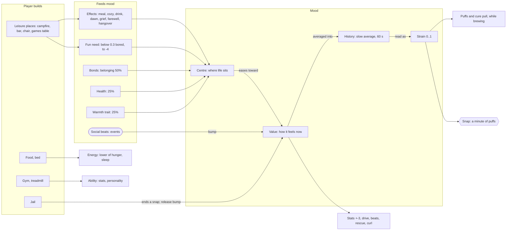

# Mood, fun and the snap

Status: built in #315, #318, #326, #327, #328. User decisions are tagged (user); the rest are picks to audit.
Diagram page: https://claude.ai/artifact/7STLrMYxefVvntA3A2vADv

## Frame
- **Two axes feed behavior: mood (how life feels) and fun (a need).** Fun touches mood only
  when unmet (user). Energy and ability stay separate and never touch mood.
- **Mood runs on three time spans:** the value (now, seconds), the centre (where life sits,
  minutes to days) and the history (a slow average of the value) (user).
- **Steam is cut as a variable.** Strain, read from mood history, does its job. Only mood
  writes history (user).
- **A snap is a bad history with no sign of getting better** (user): history at or under
  WARN_LINE (-3) through the whole spell, the slow centre under SNAP_LINE - 0.25 to start and
  under SNAP_LINE (-4), not clearly over history, for HOLD_SEC of puffs.
- **The player only builds; creatures choose** (user). A want may read mood (user: the law
  line "no want may read mood" is dropped, #310).

## Field
| Game | Recreation | Mood | Lasting misery |
|---|---|---|---|
| RimWorld | a need; bands add a mood thought (+10 full to -20 at 0) | sum of thoughts | none: breaks fire below mood lines |
| The Sims 4 | Fun is a need; low Fun gives a Tense moodlet | emotion from moodlets | none |
| ONI | adds to morale | morale | a stress meter fed by morale's gap; at 100% the dupe acts out until 60% |
| Dwarf Fortress | none | emotions | hidden stress, drifting back to neutral |
Pattern: a need gauge gives a band effect, the effect feeds mood, and lasting low mood breaks.

## Data dictionary
| Name | Range | Owner | Definition | Lifecycle |
|---|---|---|---|---|
| `fun` | 0..1 | creature, saved | the recreation need | drains awake (0.002/s), +0.008/s working; leisure fills 0.03/use (#318: at 0.01 a break could not refill a work stretch, so every worker sank to fun 0) |
| `bored` | -4..0 | derived | `-BORED_MOOD * clamp((BORED_LINE - fun) / BORED_LINE, 0, 1)` | live |
| `centre` | -5..5 | derived | 5 x (0.25 warmth + 0.25 (2 health - 1) + 0.5 belonging) + effects + bored + roommates | live |
| roommates | -1..0.5 | derived | `CreatureConfig.room_mood(room_beds)`: +0.5 alone, 0 at 2 beds, -0.25 per bed past 2, floor -1 (also no bed); in the slow centre too | each housing reassign |
| `value` | -5..5 | creature, saved | how it feels now | eases to the centre at 0.0625/s x warmth factor (0.5..1.5); social beats bump it |
| `history` | -5..5 | creature, saved | slow average of value: `dh/dt = (value - h) / HISTORY_SEC` | runs everywhere, jail included |
| `strain` | 0..1 | derived | `clamp((WARN_LINE - history) / (WARN_LINE - SNAP_LINE), 0, 1)`: how far history has gone from the warning line to the rampage line (SNAP_LINE -4, user) | live |
| `slow_centre` | -5..5 | derived | the centre without any `brief` effect (ate, meal, dawn, cozy, drink, hangover, farewell; a fixed set, so it holds at any day length): what lasts in its life (user: a moment never moves the slow picture) | live |
| `brewing` | bool | snap feature, transient | reads only the slow signals, never the value (a beat cannot flicker it); "centre" in this row means `slow_centre`. Starts when awake, not jailed, not rampaging, not tired outside FEED or SLEEP mode, at least REST_SEC after the last spell ended, `history <= WARN_LINE`, `centre < SNAP_LINE - 0.25` and `centre <= history + 0.1` (its life is that bad and not getting better; the 0.1 lets history that creeps up from below still count). Stops when asleep, jailed, rampaging or tired outside FEED or SLEEP mode, or `history > WARN_LINE`, or `centre >= SNAP_LINE`, or `centre > history + 0.25` (clearly getting better). The 0.25 gap sits below the line, so a brewer whose centre settles under -4 always reaches the snap, and one that rises to -4 always stops: no state in between | live |
| `brew_sec` | s | snap feature, transient | how long brewing has held without a break | 0 while brewing is off (asleep included), on jail entry, and when a snap fires; a tired spell pauses it only while the creature walks to a meal or bed it found (FEED or SLEEP mode); carrying a body (prisoner, downed friend, egg) pauses it too, so a carrier never snaps mid-route (relay's pick, PR 5); tired with nothing to meet the need turns brewing off (eating at hunger 0 makes every basket-fed creature tired for a few seconds a day, which must not wipe the warning) |
| effects | list | creature, saved | timed lifts on the centre (`MOODLETS`) | fade linearly over their days |
Days are short: 28 s at wave 0, +10% per wave. Effects measured in days are brief.

## Pipeline (each tick, dilated)
1. **Fun:** work and time drain it; a leisure use fills it.
2. **Centre:** resting point + bored + effects.
3. **Value:** eases toward the centre; a social beat bumps it.
4. **History:** follows the value over HISTORY_SEC.
5. **Signs:** puffs while `brewing`; strain sets their thickness (one puff, three from
   strain 0.75): they thicken as history nears the rampage line. The red balloon holds the
   cure seat's icon (the chair) in every mode while brewing, and hides once it is seated:
   the puffs alone say it is still cooling off. The wish balloon turns red while brewing, in every
   mode. A settled centre at or above -4.25 never starts puffing; beats never start or stop it.
6. **Cure pull:** brewing ends a WORK phase and keeps the job in BREAK for as long as it
   holds (`phase()` would otherwise flip back to WORK after the break), so even a driven
   worker is free to go; then the comfort seats (chair, games table) pull by
   `CURE_GAIN * strain` (no hidden pull: it starts with the puffs). A brewing creature may
   take a full seat only from a holder that is neither brewing nor bored (fun at or above
   BORED_LINE), so seats never pass back and forth between brewers; a seated brewer keeps
   its seat until brewing stops and its fun is at least BORED_LINE + 0.2, with its break
   stretched to cover that: it keeps its stay (no leave and retake) and gets no cozy
   while it brews, so the seat cures only by refilling fun. That calms a bored brewer (2 to
   7 s in the sim) and does nothing for one whose misery is enemies or health, which
   rampages after its minute of puffs. Fun fills about 0.03 per second seated, so bored clears in seconds and the centre
   rises past the stop line at once.
7. **Snap:** `brew_sec >= HOLD_SEC` (puffs have shown for a full minute, the slow centre
   under SNAP_LINE all along; no history test: it lagged so long that no playtest spell
   lasted until it held, PR 21), friendly, not tired, not jailed. Brewing is off while asleep, so a creature that
   wakes low puffs a full minute first; while tired and on its way to a meal or bed it keeps
   puffing with the count paused; tired with nowhere to go, it stops. Dawn's cheer, cozy and
   meals are left out of the slow centre, so they cannot reset the count each day. Social beats move only the value, so they neither
   start nor stop it; only a real change in its life (the centre) does.
8. **Snap end:** jail or downed ends it; the value is bumped by `RELEASE_BUMP` at that moment
   (jail entry, or going down), before the 30 s jail stay (`JAIL_SEC`). The bump comes only
   after a snap: jailing a creature that never snapped just resets `brew_sec`. No lasting effect,
   no latch; `brew_sec` starts over. Today each served jail adds +0.2 warmth for good
   (`creature.gd`), which lifts the centre by 0.25: jail slowly reforms a rampager.
9. **Readers of value:** stats ±3, work drive, social beats, rescue, the curl.

## Rules
- **A moment bumps the value; anything that lasts moves the centre** (user).
- **A rampage punch is a shove, not a hurt** (pick, fork 7): it knocks back with no HP loss,
  because health feeds the centre and a hit on a victim near the line could spread the snap.
- **Punches add no mood of their own.** A punch only hurts (`PUNCH_DAMAGE` 4, never below 1
  HP). The BULLY beat that throws it already carries the mood (+0.3 bully, -0.8 target,
  scaled by its landing roll). `STEAM_PER_HIT` goes with steam. A swing-back only hurts;
  a rampage punch only shoves (the branch in `punch()` for a rampager), so a snap never
  spreads (user).
- **The chair keeps one effect: cozy** (the reviewer's cut: a separate calm copied it),
  given only to a creature that is not brewing. As the cure it works through fun.

## Extremes and absence
| Variable | At max | At 0 | Long stretch in the middle | Removed: what stands in | Keep? |
|---|---|---|---|---|---|
| Fun | no pull | bored -4, strongest pull | sessions settle near 0.4 with leisure | nothing paces breaks; leisure has no stake | keep |
| History | high side free for a later reader | snap line reached | a lasting -4.5 snaps in ~3 min | nothing tells lasting from sudden | keep |
| Steam | snap | calm | today: -1 for 250 s snaps | strain from history | cut |

## Inputs beside neighbours
| Input | Fun | Centre | Value | History |
|---|---|---|---|---|
| Work, time awake | down | 0 | 0 | 0 |
| Leisure place | up | its effect (cozy +1.5, drink +2) | 0 | via value |
| Fun < 0.3 | n/a | bored, to -4 | 0 | via value |
| Friends, health, warmth | 0 | resting point | 0 | via value |
| Meal, dawn, grief, farewell, hangover | 0 | effect | 0 | via value |
| Social beat (incl. BULLY) | 0 (a chat is leisure) | 0 | bump | via value |
| Punch | 0 | health only | 0 | via value |
| Snap released | 0 | 0 | +3 bump | via value |
Shared row: a leisure visit fills fun and gives its effect, by design.

## Charts (sim: `HISTORY_SEC` 60, `WARN_LINE` -3, `SNAP_LINE` -4 (user), `HOLD_SEC` 60, 20 s of rampage, then 30 s of jail with the bump at entry and +0.2 warmth)
| Case (neutral warmth, healthy unless noted) | Centre | Snaps in 1500 s | Puffs before each | Puffs with no snap |
|---|---|---|---|---|
| Enemies, no leisure, settled | -3.25 | none | - | none |
| Centre -3.9, settled | -3.9 | none | - | none |
| Enemies + two BULLY hits (-0.48 each) | -3.25 | none | - | none |
| Enemies + a grief, wave 0 (28 s days) | -3.25, -5.75 fading | none | - | one 47 s near miss |
| Enemies + a grief, wave 6 and 20 | -3.25, -5.75 fading | one at 72 s | 60 s | none |
| Enemies, half health, no leisure | -4.5 | 198 s, 330 s, then jail reforms it | 66 s | none |
| Aloof, enemies, no leisure | -4.5 | 180 s, 290 s, then reformed | 60 to 66 s | none |
| Aloof, enemies, half health, no leisure | -5.75 | every ~110 s, 7 times, then jail reforms it (~840 s) | 60 s | none |
Every rampage comes after at least a minute of puffs. A settled centre at or above -4 never
puffs. Sweep (sim, centres -3 to -5.5 by 0.1, bored or not, seat or not, a BULLY hit every
30 s): no creature puffs over 300 s without a snap, none flickers more than once a minute.
In a herd with few seats, a bored creature whose life sits at -3 to -4 can puff and get
cured every 85 to 90 s for good: the bored-cure loop, a visible ask for more seats.
A grief alone never snaps a creature whose life is otherwise fine; on an already miserable
one it can, once days are long enough for the grief to outlast the minute of puffs. Every
snap case needs boredom too, so leisure stays the main stake.

| Fun left after one work session (60 s x (1 + 0.5 drive)) | discipline -1 | 0 | +1 |
|---|---|---|---|
| without the discipline fork | 0.70 | 0.40 | 0.10 (bored) |
| with it (drain x (1 - 0.5 discipline)) | 0.58 | 0.40 | 0.46 |

## Constant ledger
| Constant | Value | Kind | Why |
|---|---|---|---|
| BORED_LINE | 0.3 | limit | RimWorld's band edge; with leisure in reach a neutral worker stays above it (fun about 0.4 after a session, full after a break); a driven one dips under it at the end of long sessions |
| FUN_PER_USE | 0.03 | pace | a break (30 s, less the walk) refills a 60 s work stretch (0.6) |
| BORED_MOOD | 4.0 | weight | no leisure alone makes grumpy (-2.75), never a puff; a bored cold one stays at -4.0, under the -4.25 brew start, until hurt under 90% health; a bored neutral one needs health under 40%. At 2.0 the probe saw 0 snaps in 9 neglect runs (no front but boredom lasts); 4.5 puffed a cared-for herd for 166 s (PR 2) |
| HISTORY_SEC | 60 | pace | how long "lasting" is |
| WARN_LINE | -3 | limit | puffs start once history is this low; one unit above the snap line; strain runs from here (0) to SNAP_LINE (1) |
| SNAP_LINE | -4 | limit | how bad "bad" is (user): only a life broken on several fronts rampages |
| HOLD_SEC | 60 | limit | the warning: puffs show at least this long before any rampage |
| REST_SEC | 60 | limit | once puffs stop they cannot start again for this long, whatever the cause: one rule against every flicker (review 12: 30 s let a bored brewer cured in seconds puff again within a minute; 60 s gives none, snaps unchanged) |
| RELEASE_BUMP | +3 | weight | lifts mood above history at release; repeats come ~104 to 112 s apart |
| CURE_GAIN | 2.0 | weight | as today's STEAM_SEAT_GAIN |
Removed: STEAM_FILL, STEAM_COOL, STEAM_PER_HIT, STEAM_SEAT_DRAIN, STEAM_ANGRY, STEAM_FURIOUS
(puffs need `brewing`; strain 0.75 makes them thick).

## Loops (contradiction check)
- Low fun, lower mood, shorter work (drive), less drain. Settles.
- Brewing, cure pull, cozy lifts the centre, value rises above history, brewing stops. Settles.
- Snap, jail, release bump, value above history, slides back. Repeats only while the cause
  stays: the intended signal.
- Bullied victim: BULLY weight grows with the mood gap (`social_action.gd:217`), so a victim
  can spiral. That exists today; the snap ends it visibly. Watch it in a playtest.

## Needs: red warns before the consequence (user)
- **Red means a consequence is coming, shown before it happens** (user). The consequence is
  the bad outcome, not the routine fix: eating from a basket or sleeping in a bed is
  routine. So a need's balloon turns red `WARN_SEC` before 0 only when, now, the creature
  could not meet it the normal way (the LAW_beds sign rule, moved earlier). It reads the food
  and beds that exist now, not a forecast of 0: with the `STARVE_SEC` (40 s) wait, red always
  shows at least 40 s before a crop raid.
- **"In reach"** means what the eating code already searches: any food on the ground or in
  a basket (`_take_stock_meal`), any ripe crop (`_find_crop_meal`); neither has a distance
  cap. A usable bed is one it may use with a spot it holds or a free one (a full bed is none).
- **Hunger:** red from `WARN_SEC` before 0 when no food or stocked basket is in reach; at 0
  it waits `STARVE_SEC`, then harvests a ripe crop and eats one fruit (user; `_find_crop_meal`).
- **Sleep:** red from `WARN_SEC` of work before 0 (it drains only while working) when it has
  no usable bed; at 0 it stays tired and stops working.
- **Fun:** stays white: its 0 only makes it bored, a mood input.
- **Mood:** red while brewing, before the snap.
- **One balloon, shown in every mode while a red band holds** (today wishes show only in
  ROAM and BREAK, needs only once tired). Priority: brewing, then hunger, then sleep; a
  tired creature cannot snap, so for it the need comes first.
- **The hunger and sleep bars go** (user): the in-world bars over the body
  (`view.show_needs`) and the inspector's bars; the balloon says it. The inspector keeps the
  bed line as text.
- **Law edits:** `LAW_creature_state.md` (the need row's "red only on the brink of a snap"),
  `status_emoji_component.gd:13`'s comment, `LAW_beds.md` Signs (lines 75-79, which call a
  crop in reach white) and its in-world bars (lines 26 and 73).
- **Multiplayer:** steam, needs and mood are server-only; the synchronizer carries
  `mood_step`, `tipsy`, `bedded` and `Job:resting`. Replicate one small sign field (brew
  level 0-2 and the red flag) so a client draws the same puffs and balloon.
- `WARN_SEC`: 20 dilated s, a limit (the lead time); it scales with nothing, while needs
  scale with day length, so at wave 20 the band is a smaller share of a day.

## Open forks
1. Discipline scales work drain. Without it, disciplined creatures work longer sessions and
   end them bored; with it, every temper ends near 0.4-0.6.
2. Size of the place lifts: one visit swings up to +3.5 (bored cleared + cozy).
3. A better cure: "alone in its own Bedroom", best with furniture; a Bunkhouse gives none.
   PR 17 made the room a lasting centre term instead (Roommates below); a Bedroom as a cure
   seat stays open.
4. Bar: social place like the campfire, or the fast refill with the tipsy cost.
5. Bored shows as a card, or only on the fun bar.
6. Energy feeding mood (no today).
7. A rampage punch as a shove (picked) or a hurt (today).

## Roommates (PR 17, relay picks; user picked beds per room over floor per bed)
- **Values:** +0.5 alone, 0 for 2, -0.25 per bed past 2, floor -1 at 6+. Why: graded, so
  each bed the player adds or moves out is a choice; the floor is a quarter of bored (-4), so
  a crowded room alone never puffs, but with boredom it can. Revert: `ROOM_*` constants.
- **No bed = the floor (-1), not 0.** Why: at 0 a bedless creature would rest higher than a
  bunkhouse one, so pulling beds out would read as a mood gain. Revert: `room_mood(0)` 0.
- **Which room:** its own bed's; a sharer takes the fewest beds a close owner offers (where
  it may sleep best). Counted at each housing reassign (on change or a re-solved room, at
  most 1/s), never per tick. A sleeper's real bed for the night is not tracked.
- **Card:** 🛏 "one-bed room +0.5" (true for a sharer too), "bunkhouse -x: n beds share the
  room where it sleeps", "no bed -1"; none at 2 beds. Packed into `feel_wire` for clients.
- **Cure fork 3** stays open: the room is a lasting term, not a place a brewer walks to.
- Measured (care, 900 s, 3 seeds, SIM_WALL=0): `SIM_ROOM_BEDS=9` term -0.77/-0.75/-0.85,
  slow centre 0.16/-0.25/0.01, snaps 1; `SIM_ROOM_BEDS=1` term 0.31/0.26/0.30, centre
  0.72/0.68/1.13, snaps 0. The herds differ (37/17/52 vs 21/10/26): care keeps one spare
  bed, so 9-bed huts leave more slack for mended wilds to join; read the centre gap with that.

## Slices
1. Fun stakes: the bored band, a cheat that sets fun 0, probe: share bored, mood with and
   without leisure.
2. History and strain replace steam: brewing puffs, snap rule, release bump, punch cleanup.
   Every steam reader moves: cheats (`cheat_coordinator.gd` snap and steam, plus a new
   strain cheat), the sim driver (`headless_sim_driver.gd`), the emoji service, the
   inspector's steam bar, README, `LAW_creature_state.md`, the `LAW_time_dilation.md`
   registry (history replaces steam fill and cool), the save lists (`creature.gd` drops
   steam, `MoodComponent.SAVED` adds history), `offer_place.gd` (want's cure term, `_use`'s
   seat drain), `chair.gd` (`_use`'s drain), the chair and games table `.tres`
   descriptions, the `light_wild.gd` comment, and the tests (steam_snap, offer_place,
   police_box, save_fields, creature_inspector, housing). Plus the replicated sign field. Probe: snaps per day against today's.
3. Forks the user picks.

## Diagram

## Sources
- RimWorld [Joy](https://rimworldwiki.com/wiki/Joy), [Mood](https://rimworldwiki.com/wiki/Mood)
- The Sims 4 [emotions guide](https://simscommunity.info/2022/10/08/the-sims-4-emotions-guide/)
- ONI [Morale](https://oxygennotincluded.wiki.gg/wiki/Morale), [Stress Responses](https://oxygennotincluded.wiki.gg/wiki/Stress_Responses), [Massage Table](https://oxygennotincluded.wiki.gg/wiki/Massage_Table)
- Dwarf Fortress [Stress](https://dwarffortresswiki.org/Stress)
- Russell 1980, [A Circumplex Model of Affect](https://pdodds.w3.uvm.edu/research/papers/others/1980/russell1980a.pdf) (the arousal axis, cut)
